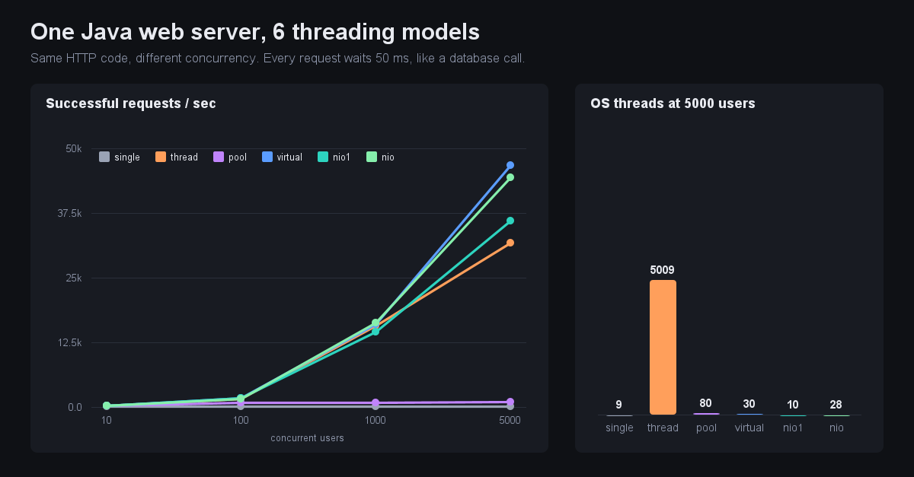
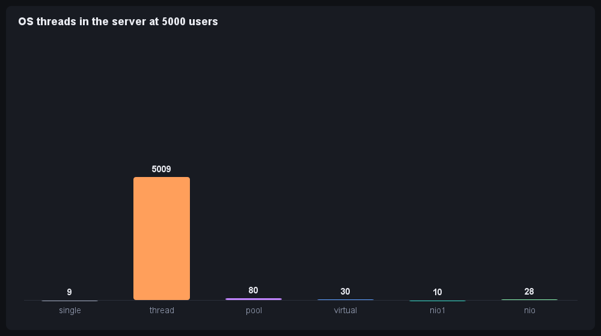

# Forge: one Java web server, six threading models, measured

Forge is a from-scratch HTTP/1.1 server (no frameworks, no dependencies, Java 21) that runs on **six different concurrency engines**, plus a built-in load tester, a self-test suite and a live dashboard.

It started from a popular "multithreaded web server in Java" tutorial (single-threaded, thread-per-client, thread pool). This version fixes that code's bugs, speaks real HTTP, adds three modern engines, and measures what each choice actually costs.



## The six engines

| Engine | How a connection is served |
|---|---|
| `single` | The accept thread serves clients one at a time |
| `thread` | A new OS thread per connection, no limit |
| `pool` | 50 fixed workers + a bounded queue of 100; when full it replies `503 Retry-After` |
| `virtual` | A new Java 21 virtual thread per connection |
| `nio1` | One event-loop thread watches every connection (the Node.js model) |
| `nio` | One event loop per CPU core (the Netty model) |

All six share the same HTTP parser, router and stats. Only *who runs the connection* changes.

## Run it

```bash
javac -d out src/forge/*.java
java -cp out forge.Main --engine=virtual --port=8080     # single thread pool virtual nio1 nio
java -cp out forge.SelfTest                              # 72 checks, all engines
java -cp out forge.Bench --seconds=3 --warmup=2 --repeats=3
```

Endpoints: `/hello`, `/work?ms=50` (simulates a slow database call), `/cpu?ms=5` (burns real CPU), `/stats` (JSON), `/dashboard` (live charts), any file under `www/`. Stats are also served on a separate localhost-only admin port (`--admin=`, default port+1) so they stay readable while the main port is overloaded.

## Results

Machine: Ryzen 7 7840HS, 16 logical cores, Windows 11. The server runs in its own JVM; the load generator is a separate process. Each cell is the median of 3 runs after a 2 s warmup, 3 s measured. Full tables with spread, p50/p99/p99.9, failure types and memory: [results.md](results.md).

### Each request waits 50 ms (like a database call): successful requests per second

| Users | single | thread | pool(50) | virtual | nio1 | nio |
|---:|---:|---:|---:|---:|---:|---:|
| 10 | 18 | 155 | 156 | 170 | 167 | 157 |
| 100 | 7 (54% timed out) | 1,558 | 800 | 1,648 | 1,633 | 1,559 |
| 1,000 | 14 (99.8% never connected) | 15,595 | 817 (51% got 503) | 15,906 | 14,493 | 16,273 |
| 5,000 | 14 | 31,684 | 892 (84% got 503) | 46,635 | 35,936 | 44,268 |

### What 5,000 users cost the server

| | thread | pool | virtual | nio1 | nio |
|---|---:|---:|---:|---:|---:|
| OS threads | **5,009** | 80 | 30 | 10 | 28 |
| Memory committed (MB) | **868** | 378 | 362 | 384 | 409 |
| p99 latency (ms) | 244 | 188 | 178 | 197 | 183 |



### Each request computes for 5 ms: requests per second at 256 users

| single | thread | pool | virtual | nio1 | nio |
|---:|---:|---:|---:|---:|---:|
| 187 | 2,552 | 2,553 | 2,396 | **209** | 2,962 |

The ideal ceiling on 16 hardware threads is 3,200 (16 x 200).

## What the numbers say

- **Single-threaded collapses at once.** At 100 users more than half the requests time out, because one slow request blocks everyone.
- **Thread-per-connection works, but you pay for it.** At 5,000 users it held 5,009 OS threads and about 2.4x the memory of the virtual and event-loop engines (868 MB against about 360 to 410 MB), and had the worst p99.
- **Virtual threads and the event loops serve 5,000 users on 10 to 30 threads.** Virtual threads give the scalability of an event loop while the code stays plain blocking code.
- **The pool is capped by design.** It stays near 800 to 900 requests/s no matter how many users arrive, and turns the rest away with a quick `503` instead of running out of memory. That is the intended behaviour of a bounded queue.
- **One event loop cannot compute in parallel.** With CPU-heavy requests, `nio1` manages about 200 requests/s (one core) while `nio` with a loop per core reaches 2,962. Waiting is free for an event loop; computing is not.

## Things I am not claiming

- **The order at 5,000 users is not stable.** Two full runs of the same code gave `thread` about 31,000 both times, but `virtual` 36,674 then 46,635, and `nio` 31,393 then 44,268. I only claim virtual and nio are at least as fast as thread-per-connection, not by how much. The thread count, memory and pool results were steady.
- **One machine, one run each.** Client and server share the same 16 cores, so absolute numbers will differ elsewhere.
- **"Memory committed" is what the OS reserved for the process**, not memory in use. It includes thread stacks, which are not part of the Java heap.
- **The simulated work is `Thread.sleep` or a CPU loop**, not a real database.

## Bugs found in the original tutorial code (and fixed here)

| Original | Problem |
|---|---|
| Sends one line of text over a raw socket | Not HTTP; browsers and `curl` can't use it |
| Single-threaded client uses port 8090, server uses 8010 | Client never connects |
| Sockets never closed in the single-threaded server | Leaks a file handle per connection |
| `setSoTimeout` on the listening socket | The whole server crashes after 20 to 70 s without a new client |
| `newFixedThreadPool` | Unbounded queue: overload grows memory until it dies |
| One thread per connection, no limit | Memory and thread exhaustion under load |
| Handlers do no work, nothing is measured | Cannot tell the models apart |
| Pool only shut down on crash | No clean shutdown |

## Design notes

- `Response.waitMs`: the router never sleeps. Blocking engines call `Thread.sleep`; the event loop schedules a timer and keeps serving. That is exactly the difference the benchmark exposes.
- Path traversal: `/../src/Main.java` resolves outside `www/`, so it gets `403`.
- The pool answers `503` itself after reading the request, then half-closes. Closing with unread bytes makes TCP send a reset, and the client never sees the `503`.
- Keep-alive is on for `thread`, `virtual`, `nio1`, `nio`. It is off for `single` and `pool`, because a kept-open connection would pin a worker.
- `/cpu` does a fixed amount of work, calibrated at startup, not "spin for 5 ms of wall time". With more threads than cores, wall-clock spinning lets the OS pause threads mid-spin and quietly makes each request do less work.

## How the benchmark avoids fooling itself

Three bugs in earlier versions of this benchmark are fixed, and each would have produced believable but wrong charts:

1. **Client and server in one JVM** shared threads and heap. The server now runs in its own process.
2. **The load generator ran out of ports.** A normally closed connection keeps its port reserved (TIME_WAIT), and Windows has about 16,000. Later engines showed fake "could not connect" errors. Closing with linger 0 fixes it.
3. **Clients reconnected in a tight loop** against a refusing server, which blocked the measuring probe and printed 0 threads and 0 MB. Clients now back off briefly after a failure, and any missing sample shows as `n/a`, never as 0.

## Known limits

- GET and HEAD only: no request bodies, no TLS, no HTTP/2.
- The self-test checks behaviour (correct replies, 503 when full, clean stop). It cannot prove an absence of data races.
- Pool and event-loop sizes are fixed at the values above, not tuned.
